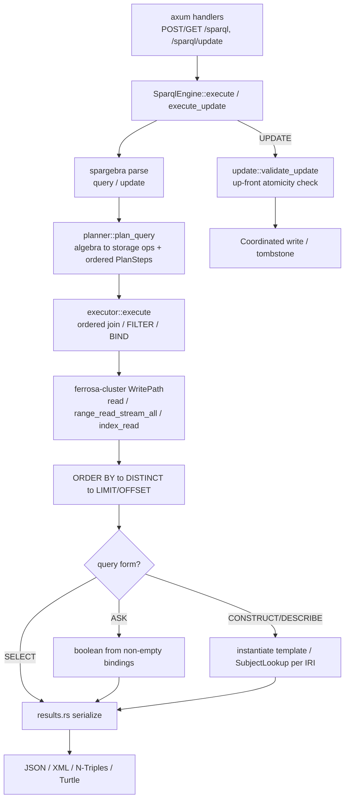

# ferrosa-sparql — Architecture Overview

## Purpose & boundary

`ferrosa-sparql` is the W3C SPARQL front-end. It owns SPARQL parsing, algebra →
storage planning, query execution, SPARQL UPDATE, and result serialization. It
does **not** own storage durability, replication, indexing, or schema — it
delegates reads and mutations to `ferrosa-cluster`'s live write path.
`ferrosa-storage` supplies dataset admission and table registration.

The RDF data model is mapped onto exactly one CQL table per keyspace:

```
rdf_triples_v2 : ((graph, subject), predicate, object, object_identity)
                 regular cols: datatype=0, language=1, object_type=2
rdf_triples    : historical v1 only; never served by this core
```

The partition key is `(graph, subject)`; the keyspace chooses the table. Named
graphs and the default graph are isolated. The lexical object component supports
candidate indexing; the third component carries versioned kind/datatype/language
identity. V1 has a separate schema and historical metadata ordinals and requires
explicit migration before serving.

## Module map

| Module | Responsibility |
|--------|----------------|
| `engine` (`src/engine.rs`, ~600 LoC) | `SparqlEngine`: parse→plan→execute orchestration, `SparqlResult`, ASK/CONSTRUCT/DESCRIBE graph assembly, JSON/XML/NT/Turtle dispatch |
| `planner` (`src/planner.rs`, ~770 LoC) | `spargebra` algebra → `QueryPlan` of `TripleOp`s; per-pattern access-method selection; CONSTRUCT/DESCRIBE mode detection |
| `executor` (`src/executor.rs`, ~1150 LoC) | Streaming triple-pattern scans + `ExecutionLimits` row bound, LIMIT pushdown, nested-loop join, constant-term enforcement, FILTER/ORDER BY/DISTINCT/LIMIT, composite-key decode, tombstone skipping, ObjectScan index |
| `update` (`src/update.rs`, ~730 LoC) | INSERT/DELETE DATA, DELETE WHERE, DELETE/INSERT WHERE, CLEAR, DROP, CREATE; up-front atomicity validation; one shared tombstone primitive |
| `property_path` (`src/property_path.rs`, ~440 LoC) | `+ * ? ^` evaluation via BFS with cycle detection over a streamed, bounded adjacency read |
| `bind` (`src/bind.rs`) | RDF-term-preserving Extend expressions, checked integer arithmetic and bounded decimal division |
| `filter` (`src/filter.rs`, ~490 LoC) | `Expression` evaluation: comparisons, boolean ops, arithmetic, a function subset; `unsupported_expr` gate for ORDER BY fail-loud |
| `aggregate` (`src/aggregate.rs`) | Bounded global/grouped COUNT with RDF-term DISTINCT identity |
| `protocol` / `negotiation` | Transport cardinality/version/dataset validation and query-form-aware Accept selection |
| `results` (`src/results.rs`) | `Binding`, `SparqlJsonResults`, `ResultFormat`; JSON / W3C XML / N-Triples serializers |
| `http` (`src/http.rs`, ~234 LoC) | axum router, content negotiation, 1 MiB body limit, error→status mapping |
| `triple_store` (`src/triple_store.rs`) | v2 schema/strict identity codec, v1 schema/decoder, checked keys and legacy fence |
| `rdf_star` (`src/rdf_star.rs`) | RDF\* annotation evaluation stub — fail-loud, not implemented |
| `namespace` (`src/namespace.rs`) | Standard prefix table (rdf, rdfs, owl, xsd, foaf, …) |

## Data flow



**Read path.** A bound subject plans to `SubjectLookup` (point read on the
partition key); a bound predicate to `PredicateScan` (streaming range scan +
filter); a bound object to `ObjectScan` (secondary index
`rdf_triples_object_idx` when this node declares it — checked up front with
`WritePath::declares_index_locally`, because an undeclared index read is now
refused rather than answered empty — otherwise a streaming range scan; registration
declares the index and non-current backfills also use the scan); nothing bound
to `FullScan`. Range scans pull one partition at a time from
`WritePath::range_read_stream_all` and bind each row as it arrives — no
intermediate `Vec` of fetched triples exists. The executor folds each
`TripleOp`'s rows into the running binding set with a compatibility check on both
kind, lexical value, datatype and language, and enforces every constant term in the pattern (the
access path is a pushdown, not the whole match).

**Write path.** UPDATE first validates operation shapes and constant keys, then
applies operations sequentially. Resolved DELETE/INSERT template keys are checked
before that operation mutates; storage failures are not rolled back. Inserts
write a live row; every delete form funnels
through one `tombstone_triple` primitive that writes a deletion-marker row with
`LivenessInfo::NONE` and clustering identical to the live row it must shadow.

## Key invariants

1. **Graph and keyspace are separate.** Default and named graph scans/paths and
   deletes isolate the selected graph. CLEAR/DROP DEFAULT, NAMED and ALL retain
   each scanned row's actual graph when constructing tombstones.
2. **UPDATE atomicity by up-front rejection.** Because execution has no rollback,
   `validate_update` rejects the whole request before any mutation if any op is
   unaddressable — preventing a desugared `Drop` from wiping data before a later
   op fails.
3. **Tombstone clustering must shadow the live row exactly.** Inserts and deletes
   share `triple_store::encode_clustering` (strict `[u16 len][bytes]`, no separator), so
   a tombstone matches the row it deletes; `LivenessInfo::NONE` prevents
   resurrection.
4. **Fail loud over silent wrong answers.** RDF\* annotation, `LOAD`,
   cross-graph ops, and unsupported ORDER BY expressions return
   `SparqlError::Plan`, not approximate results.
5. **Deleted rows never surface.** The executor skips any row whose deletion
   marker is non-live (URS-QEC-D05).
6. **Complete result, or an error — never a silent truncation.**
   `ExecutionLimits::max_rows` (from `SparqlConfig::max_rows`) is the one row
   bound. It is enforced at the SOURCE, as storage rows arrive from the
   partition stream, and on every operator's solution buffer. Crossing it
   returns `SparqlError::Execution`. Blocking operators (`ORDER BY`, `DISTINCT`,
   property-path BFS) may buffer but not exceed it.
7. **A constant is a match constraint in every position.** The access method is
   chosen from ONE bound term, but `try_bind_triple` re-checks subject,
   predicate, and object — including kind, datatype and language, so an IRI constant never matches
   a literal spelling the same characters. A blank node in a pattern is a
   non-selectable variable and constrains nothing.
8. **LIMIT pushdown only where it is provably safe.** The scan stops after
   `offset + limit` solutions only for a single triple pattern with no
   `ORDER BY`, `DISTINCT`, `FILTER`, or graph query form above it; those
   operators either block or drop rows after binding, so an early stop would
   return the wrong rows or too few. LIMIT/OFFSET arithmetic saturates — both
   values are attacker-controlled `usize`.

## Position in the dependency graph

Front-end leaf: depends on `ferrosa-cluster`, `ferrosa-storage`,
`ferrosa-common`, `ferrosa-sstable`, `ferrosa-index`, `ferrosa-schema`; depended
on only by the `ferrosa` binary. See the
[root crate index](../../specs/crates.md) for the full graph.

## Extend / BIND execution (t_c5b544d4)

`QueryPlan::steps` retains triple-operation and filter indices plus Extend and
scoped Join steps. The storage access inventory remains in `ops`; it does not
control expression ordering. Each Join operand starts with the empty solution
mapping and its own expression scope. BGP joins still stream the storage side;
explicit Join operands and their compatible combinations obey `max_rows`.
LIMIT pushdown is disabled for explicit Join steps and for any FILTER.

The shared executor evaluates Extend per solution, retaining the row when the
expression has an unbound operand, invalid type/value, overflow or zero divisor.
The BIND evaluator preserves complete RDF terms for constants/aliases and uses
checked i64 arithmetic without float conversion. Integer division emits decimal
lexical values with at most 18 fractional digits (truncation toward zero).
Unsupported expression forms fail planning; arithmetic on decimal/float/double
operands fails explicitly. These restrictions do not affect constant/alias
bindings of those RDF terms. See README for the supported subset.

Regression evidence: `tests/sparql_executor_invariants.rs::baseline_bind`, through
the real planner and both public executor entry points. Covers empty identity,
dependent binds, expression errors, BGP/BIND/FILTER order, nested scopes, RDF
term metadata, integer precision, overflow and division.

## RDF identity format boundary

Fresh data serves v2 exclusively. Canonical metadata column order is used for
new SSTables; the v1 decoder retains historical ordinals. All new mutations use
checked keys; the total partition key and every clustering/identity component
must fit u16 lengths. Partition keys have separator bytes, clustering keys do not.

The public engine refuses legacy evidence before v2 registration and each
read/update unless a durable completed migration matches both table incarnations.
`migration::OfflineMigration` owns recovered local storage and performs explicit,
quiesced Direct-mode copy through bounded fragments. It checks source/target
recovery admission, validates all source identities through the lexical index,
counts the target independently, flushes, and durably publishes completion.
Interrupted targets remain fenced. A completed rerun validates provenance without
recopying retired v1. Empty registry snapshots retain the flat storage catalog
fallback so neither source nor target disappears on restart. See
[RDF term identity cutover](rdf-term-identity-cutover.md).

CLEAR/DROP uses two streaming passes: validation followed by deletion. Each pass
holds storage fragments, rather than buffering every selected triple. A preflight
error leaves the data unchanged; this is not a transaction over concurrent writers.

## COUNT and SPARQL 1.2 results

The supported COUNT subset streams a single triple pattern, FILTER and BIND
into counters. Group keys and explicit DISTINCT sets are bounded by max_rows;
complex joins/path input use the existing bounded evaluator. COUNT scans decode
triples and are O(N). Unsupported aggregate/input algebra fails during planning.

Bindings are typed RDF terms, with recursive triple objects and directional
literals for JSON 1.2 SELECT expressions. Scalar v2 storage identities and
language datatype metadata remain unchanged. RDF 1.2 persistence and graph
output remain unavailable, with explicit rejection rather than discarded data.
HTTP negotiation uses the query form, q/specificity and explicit JSON version.
Dataset transport overrides are refused before writes; service URI BASE and
operation/version cardinality are validated. See the crate README for the dated
W3C contracts and remaining conformance limits.

### Selective join allocation

Before extending a solution, the executor compares bound subject, predicate and
object terms by borrowed identity. Rejected pairs do not clone the solution.
Fully bound shared-subject joins use an index of borrowed `(term kind, value)`
keys to input positions; matching duplicates remain distinct. If any subject is
unbound, the executor retains the general compatibility join. Other joins may
still compare every pair, and intermediate solution vectors remain bounded by
execution limits rather than fully pipelined.

The binary supplies a shared live `ArcSwap<WritePath>` rather than a permanent standalone path. Each query or update snapshots that source once. Updates reject pair-secondary authority before table registration; the selected pair coordinator also enforces authority during mutation admission.

All SPARQL inserts and tombstones use the deployment coordinator. Pair updates request RF2 QUORUM, including the configured singleton S3 barrier; unavailable and degraded paths reject writes. Cluster updates use the coordinator’s configured default consistency and replication factor. These are per-row acknowledgments; an update request is not a distributed atomic transaction.
