# Lean extraction inventory — 15/27 crates measured

Toolchain: 7b462d9159db2ed3015162352183906a30bfafc6 · aeneas 9b1eec9 · Lean (version 4.35.0, x86_64-unknown-linux-gnu, commit eb6cafb7290e8bd5f2937522d8d804f58f02bafc, Release)
Budgets: whole crate unboundeds, module 0s, sample fallback off
Updated: 2026-10-31T18:41:32+00:00

Generated by `scripts/lean_gap_inventory.py`. A crate is re-measured when its fingerprint
changes -- its own sources, its transitive workspace dependencies' sources, or the
toolchain -- and whenever its last row did not measure the crate end to end. `scope` says
which unit the numbers describe, so a module row is never read as a crate row.

## Checklist

- [x] ferrosa-alloc-count — aeneas
- [ ] ferrosa-jsonb — aeneas
- [ ] ferrosa-common — aeneas
- [ ] ferrosa-sstable — aeneas-crash
- [x] ferrosa-cdc — aeneas
- [ ] ferrosa-index — aeneas-crash
- [ ] ferrosa-net — aeneas-crash
- [ ] ferrosa-schema — modules
- [ ] ferrosa-row-bridge — aeneas
- [ ] ferrosa-sched — aeneas
- [ ] ferrosa-storage — charon
- [ ] ferrosa-cluster — modules-partial
- [ ] ferrosa-udf — aeneas
- [ ] ferrosa-session — aeneas
- [ ] ferrosa-cql — aeneas
- [ ] ferrosa-ctl — unmeasured
- [ ] ferrosa-flight — unmeasured
- [ ] ferrosa-graph — unmeasured
- [ ] ferrosa-index-builder — unmeasured
- [ ] ferrosa-sim — unmeasured
- [ ] ferrosa-jepsen — unmeasured
- [ ] ferrosa-loadgen — unmeasured
- [ ] ferrosa-sql — unmeasured
- [ ] ferrosa-postgres — unmeasured
- [ ] ferrosa-sparql — unmeasured
- [ ] ferrosa-view — unmeasured
- [ ] red-ledger — unmeasured

## Results

| crate | ok | scope | stage | transl | lean | sorry | s | measured |
|---|---|---|---|---|---|---|---|---|
| ferrosa-alloc-count | x | crate | aeneas | 0 | 0 | 12 | 5 | 2026-10-31T17:37:03+00:00 |
| ferrosa-jsonb |   | crate | aeneas | 0 | 29 | 373 | 22 | 2026-10-31T17:37:25+00:00 |
| ferrosa-common |   | crate | aeneas | 0 | 94 | 326 | 198 | 2026-10-31T17:40:43+00:00 |
| ferrosa-sstable |   | crate | aeneas-crash | None | None | None | 135 | 2026-10-31T17:42:58+00:00 |
| ferrosa-cdc | x | crate | aeneas | 0 | 0 | 4 | 5 | 2026-10-31T17:43:03+00:00 |
| ferrosa-index |   | crate | aeneas-crash | None | None | None | 6 | 2026-10-31T17:43:08+00:00 |
| ferrosa-net |   | crate | aeneas-crash | None | None | None | 512 | 2026-10-31T17:51:40+00:00 |
| ferrosa-schema |   | modules (6 measured) | modules | None | None | None | 170 | 2026-10-31T18:10:28+00:00 |
| ferrosa-row-bridge |   | crate | aeneas | 0 | 66 | 266 | 14 | 2026-10-31T14:52:08+00:00 |
| ferrosa-sched |   | crate | aeneas | 0 | 2 | 130 | 17 | 2026-10-31T14:43:40+00:00 |
| ferrosa-storage |   | crate | charon | None | None | None | 28 | 2026-10-31T16:31:05+00:00 |
| ferrosa-cluster |   | modules (2 measured) | modules-partial | None | None | None | 1537 | 2026-10-31T15:29:43+00:00 |
| ferrosa-udf |   | crate | aeneas | 0 | 62 | 264 | 38 | 2026-10-31T14:51:54+00:00 |
| ferrosa-session |   | crate | aeneas | 0 | 16 | 74 | 7 | 2026-10-31T15:32:16+00:00 |
| ferrosa-cql |   | crate | aeneas | 0 | 71 | 849 | 606 | 2026-10-31T18:41:32+00:00 |
| ferrosa-ctl |   | - | unmeasured | - | - | - | - | - |
| ferrosa-flight |   | - | unmeasured | - | - | - | - | - |
| ferrosa-graph |   | - | unmeasured | - | - | - | - | - |
| ferrosa-index-builder |   | - | unmeasured | - | - | - | - | - |
| ferrosa-sim |   | - | unmeasured | - | - | - | - | - |
| ferrosa-jepsen |   | - | unmeasured | - | - | - | - | - |
| ferrosa-loadgen |   | - | unmeasured | - | - | - | - | - |
| ferrosa-sql |   | - | unmeasured | - | - | - | - | - |
| ferrosa-postgres |   | - | unmeasured | - | - | - | - | - |
| ferrosa-sparql |   | - | unmeasured | - | - | - | - | - |
| ferrosa-view |   | - | unmeasured | - | - | - | - | - |
| red-ledger |   | - | unmeasured | - | - | - | - | - |

## Dependency order

```mermaid
graph TD
  ferrosa_jsonb --> ferrosa_common
  ferrosa_common --> ferrosa_sstable
  ferrosa_common --> ferrosa_cdc
  ferrosa_sstable --> ferrosa_cdc
  ferrosa_common --> ferrosa_index
  ferrosa_common --> ferrosa_net
  ferrosa_common --> ferrosa_schema
  ferrosa_index --> ferrosa_schema
  ferrosa_sstable --> ferrosa_schema
  ferrosa_common --> ferrosa_row_bridge
  ferrosa_jsonb --> ferrosa_row_bridge
  ferrosa_schema --> ferrosa_row_bridge
  ferrosa_sstable --> ferrosa_row_bridge
  ferrosa_cdc --> ferrosa_storage
  ferrosa_common --> ferrosa_storage
  ferrosa_index --> ferrosa_storage
  ferrosa_jsonb --> ferrosa_storage
  ferrosa_row_bridge --> ferrosa_storage
  ferrosa_sched --> ferrosa_storage
  ferrosa_schema --> ferrosa_storage
  ferrosa_sstable --> ferrosa_storage
  ferrosa_cdc --> ferrosa_cluster
  ferrosa_common --> ferrosa_cluster
  ferrosa_index --> ferrosa_cluster
  ferrosa_net --> ferrosa_cluster
  ferrosa_schema --> ferrosa_cluster
  ferrosa_sstable --> ferrosa_cluster
  ferrosa_storage --> ferrosa_cluster
  ferrosa_common --> ferrosa_udf
  ferrosa_cluster --> ferrosa_session
  ferrosa_common --> ferrosa_session
  ferrosa_net --> ferrosa_session
  ferrosa_schema --> ferrosa_session
  ferrosa_storage --> ferrosa_session
  ferrosa_udf --> ferrosa_session
  ferrosa_cdc --> ferrosa_cql
  ferrosa_cluster --> ferrosa_cql
  ferrosa_common --> ferrosa_cql
  ferrosa_index --> ferrosa_cql
  ferrosa_jsonb --> ferrosa_cql
  ferrosa_net --> ferrosa_cql
  ferrosa_row_bridge --> ferrosa_cql
  ferrosa_sched --> ferrosa_cql
  ferrosa_schema --> ferrosa_cql
  ferrosa_session --> ferrosa_cql
  ferrosa_sstable --> ferrosa_cql
  ferrosa_storage --> ferrosa_cql
  ferrosa_udf --> ferrosa_cql
  ferrosa_cluster --> ferrosa_ctl
  ferrosa_common --> ferrosa_ctl
  ferrosa_cql --> ferrosa_ctl
  ferrosa_schema --> ferrosa_ctl
  ferrosa_session --> ferrosa_ctl
  ferrosa_sstable --> ferrosa_ctl
  ferrosa_storage --> ferrosa_ctl
  ferrosa_udf --> ferrosa_ctl
  ferrosa_cluster --> ferrosa_flight
  ferrosa_common --> ferrosa_flight
  ferrosa_cql --> ferrosa_flight
  ferrosa_net --> ferrosa_flight
  ferrosa_schema --> ferrosa_flight
  ferrosa_alloc_count --> ferrosa_graph
  ferrosa_cluster --> ferrosa_graph
  ferrosa_common --> ferrosa_graph
  ferrosa_index --> ferrosa_graph
  ferrosa_net --> ferrosa_graph
  ferrosa_schema --> ferrosa_graph
  ferrosa_sstable --> ferrosa_graph
  ferrosa_storage --> ferrosa_graph
  ferrosa_common --> ferrosa_index_builder
  ferrosa_index --> ferrosa_index_builder
  ferrosa_sstable --> ferrosa_index_builder
  ferrosa_storage --> ferrosa_index_builder
  ferrosa_common --> ferrosa_sim
  ferrosa_sim --> ferrosa_jepsen
  ferrosa_common --> ferrosa_loadgen
  ferrosa_cql --> ferrosa_loadgen
  ferrosa_schema --> ferrosa_loadgen
  ferrosa_sstable --> ferrosa_loadgen
  ferrosa_storage --> ferrosa_loadgen
  ferrosa_common --> ferrosa_sql
  ferrosa_jsonb --> ferrosa_sql
  ferrosa_storage --> ferrosa_sql
  ferrosa_cluster --> ferrosa_postgres
  ferrosa_common --> ferrosa_postgres
  ferrosa_jsonb --> ferrosa_postgres
  ferrosa_net --> ferrosa_postgres
  ferrosa_row_bridge --> ferrosa_postgres
  ferrosa_sched --> ferrosa_postgres
  ferrosa_schema --> ferrosa_postgres
  ferrosa_sql --> ferrosa_postgres
  ferrosa_sstable --> ferrosa_postgres
  ferrosa_storage --> ferrosa_postgres
  ferrosa_cluster --> ferrosa_sparql
  ferrosa_common --> ferrosa_sparql
  ferrosa_index --> ferrosa_sparql
  ferrosa_net --> ferrosa_sparql
  ferrosa_schema --> ferrosa_sparql
  ferrosa_sstable --> ferrosa_sparql
  ferrosa_storage --> ferrosa_sparql
  ferrosa_schema --> ferrosa_view
```

