# Lean extraction inventory — 27/28 crates measured

Toolchain: 7b462d9159db2ed3015162352183906a30bfafc6 · aeneas 80b690a9ad1ef1fb97fee23ef1e1c9486ff8f8b9 · Lean (version 4.35.0, x86_64-unknown-linux-gnu, commit eb6cafb7290e8bd5f2937522d8d804f58f02bafc, Release)
Budgets: whole crate unboundeds, module 0s, sample fallback off
Updated: 2026-11-09T01:21:49+00:00

Generated by `scripts/lean_gap_inventory.py`. A crate is re-measured when its fingerprint
changes -- its own sources, its transitive workspace dependencies' sources, or the
toolchain -- and whenever its last row did not measure the crate end to end. `scope` says
which unit the numbers describe, so a module row is never read as a crate row.

## Checklist

- [x] ferrosa-alloc-count — aeneas
- [ ] ferrosa-jsonb — aeneas
- [ ] ferrosa-common — aeneas
- [ ] ferrosa-sstable — aeneas-crash
- [x] ferrosa-cdc — aeneas
- [ ] ferrosa-index — aeneas-crash
- [ ] ferrosa-net — aeneas-crash
- [ ] ferrosa-schema — modules
- [ ] ferrosa-row-bridge — aeneas
- [ ] ferrosa-sched — aeneas
- [ ] ferrosa-storage — charon
- [ ] ferrosa-cluster — modules-partial
- [ ] ferrosa-plpgsql — unmeasured
- [ ] ferrosa-udf — aeneas
- [ ] ferrosa-session — aeneas
- [ ] ferrosa-cql — aeneas
- [ ] ferrosa-ctl — aeneas-crash
- [ ] ferrosa-flight — aeneas
- [ ] ferrosa-graph — aeneas-crash
- [ ] ferrosa-index-builder — aeneas-crash
- [ ] ferrosa-sim — aeneas
- [ ] ferrosa-jepsen — aeneas
- [ ] ferrosa-loadgen — aeneas
- [ ] ferrosa-sql — aeneas-crash
- [ ] ferrosa-postgres — aeneas
- [ ] ferrosa-sparql — aeneas
- [ ] ferrosa-view — modules
- [x] red-ledger — aeneas

## Results

| crate | ok | scope | stage | transl | lean | sorry | s | measured |
|---|---|---|---|---|---|---|---|---|
| ferrosa-alloc-count | x | crate | aeneas | 0 | 0 | 12 | 6 | 2026-11-01T05:54:45+00:00 |
| ferrosa-jsonb |   | crate | aeneas | 0 | 29 | 373 | 55 | 2026-11-01T05:55:40+00:00 |
| ferrosa-common |   | crate | aeneas | 0 | 94 | 326 | 198 | 2026-10-31T17:40:43+00:00 |
| ferrosa-sstable |   | crate | aeneas-crash | None | None | None | 199 | 2026-11-01T06:10:04+00:00 |
| ferrosa-cdc | x | crate | aeneas | 0 | 0 | 4 | 6 | 2026-11-01T05:55:46+00:00 |
| ferrosa-index |   | crate | aeneas-crash | None | None | None | 7 | 2026-11-01T06:10:11+00:00 |
| ferrosa-net |   | crate | aeneas-crash | None | None | None | 1957 | 2026-10-31T23:23:24+00:00 |
| ferrosa-schema |   | modules (6 measured) | modules | None | None | None | 170 | 2026-10-31T18:10:28+00:00 |
| ferrosa-row-bridge |   | crate | aeneas | 0 | 66 | 266 | 24 | 2026-11-01T05:56:10+00:00 |
| ferrosa-sched |   | crate | aeneas | 0 | 2 | 130 | 16 | 2026-11-01T05:56:26+00:00 |
| ferrosa-storage |   | crate | charon | None | None | None | 32 | 2026-10-31T19:29:28+00:00 |
| ferrosa-cluster |   | modules (2 measured) | modules-partial | None | None | None | 1537 | 2026-10-31T15:29:43+00:00 |
| ferrosa-plpgsql |   | - | unmeasured | - | - | - | - | - |
| ferrosa-udf |   | crate | aeneas | 0 | 62 | 297 | 23 | 2026-11-09T01:15:39+00:00 |
| ferrosa-session |   | crate | aeneas | 0 | 16 | 74 | 50 | 2026-11-01T05:57:54+00:00 |
| ferrosa-cql |   | crate | aeneas | 0 | 71 | 849 | 606 | 2026-10-31T18:41:32+00:00 |
| ferrosa-ctl |   | crate | aeneas-crash | None | None | None | 86 | 2026-11-01T06:36:55+00:00 |
| ferrosa-flight |   | crate | aeneas | 0 | 29 | 622 | 98 | 2026-11-01T05:59:31+00:00 |
| ferrosa-graph |   | crate | aeneas-crash | None | None | None | 66 | 2026-11-01T06:38:01+00:00 |
| ferrosa-index-builder |   | crate | aeneas-crash | None | None | None | 158 | 2026-11-01T06:40:39+00:00 |
| ferrosa-sim |   | crate | aeneas | 0 | 85 | 149 | 21 | 2026-11-01T05:59:52+00:00 |
| ferrosa-jepsen |   | crate | aeneas | 0 | 90 | 450 | 1301 | 2026-10-31T19:55:30+00:00 |
| ferrosa-loadgen |   | crate | aeneas | 0 | 1 | 396 | 78 | 2026-11-01T06:01:10+00:00 |
| ferrosa-sql |   | crate | aeneas-crash | None | None | None | 155 | 2026-11-01T06:43:14+00:00 |
| ferrosa-postgres |   | crate | aeneas | 0 | 73 | 893 | 83 | 2026-11-09T01:21:49+00:00 |
| ferrosa-sparql |   | crate | aeneas | 0 | 83 | 477 | 89 | 2026-11-01T06:04:51+00:00 |
| ferrosa-view |   | modules (1 measured) | modules | None | None | None | 12 | 2026-10-31T20:40:03+00:00 |
| red-ledger | x | crate | aeneas | 0 | 0 | 3 | 17 | 2026-11-01T06:05:08+00:00 |

## Dependency order

```mermaid
graph TD
  ferrosa_jsonb --> ferrosa_common
  ferrosa_common --> ferrosa_sstable
  ferrosa_common --> ferrosa_cdc
  ferrosa_sstable --> ferrosa_cdc
  ferrosa_common --> ferrosa_index
  ferrosa_common --> ferrosa_net
  ferrosa_common --> ferrosa_schema
  ferrosa_index --> ferrosa_schema
  ferrosa_sstable --> ferrosa_schema
  ferrosa_common --> ferrosa_row_bridge
  ferrosa_jsonb --> ferrosa_row_bridge
  ferrosa_schema --> ferrosa_row_bridge
  ferrosa_sstable --> ferrosa_row_bridge
  ferrosa_cdc --> ferrosa_storage
  ferrosa_common --> ferrosa_storage
  ferrosa_index --> ferrosa_storage
  ferrosa_jsonb --> ferrosa_storage
  ferrosa_row_bridge --> ferrosa_storage
  ferrosa_sched --> ferrosa_storage
  ferrosa_schema --> ferrosa_storage
  ferrosa_sstable --> ferrosa_storage
  ferrosa_cdc --> ferrosa_cluster
  ferrosa_common --> ferrosa_cluster
  ferrosa_index --> ferrosa_cluster
  ferrosa_net --> ferrosa_cluster
  ferrosa_schema --> ferrosa_cluster
  ferrosa_sstable --> ferrosa_cluster
  ferrosa_storage --> ferrosa_cluster
  ferrosa_common --> ferrosa_udf
  ferrosa_plpgsql --> ferrosa_udf
  ferrosa_cluster --> ferrosa_session
  ferrosa_common --> ferrosa_session
  ferrosa_net --> ferrosa_session
  ferrosa_schema --> ferrosa_session
  ferrosa_storage --> ferrosa_session
  ferrosa_udf --> ferrosa_session
  ferrosa_cdc --> ferrosa_cql
  ferrosa_cluster --> ferrosa_cql
  ferrosa_common --> ferrosa_cql
  ferrosa_index --> ferrosa_cql
  ferrosa_jsonb --> ferrosa_cql
  ferrosa_net --> ferrosa_cql
  ferrosa_row_bridge --> ferrosa_cql
  ferrosa_sched --> ferrosa_cql
  ferrosa_schema --> ferrosa_cql
  ferrosa_session --> ferrosa_cql
  ferrosa_sstable --> ferrosa_cql
  ferrosa_storage --> ferrosa_cql
  ferrosa_udf --> ferrosa_cql
  ferrosa_cluster --> ferrosa_ctl
  ferrosa_common --> ferrosa_ctl
  ferrosa_cql --> ferrosa_ctl
  ferrosa_schema --> ferrosa_ctl
  ferrosa_session --> ferrosa_ctl
  ferrosa_sstable --> ferrosa_ctl
  ferrosa_storage --> ferrosa_ctl
  ferrosa_udf --> ferrosa_ctl
  ferrosa_cluster --> ferrosa_flight
  ferrosa_common --> ferrosa_flight
  ferrosa_cql --> ferrosa_flight
  ferrosa_net --> ferrosa_flight
  ferrosa_schema --> ferrosa_flight
  ferrosa_alloc_count --> ferrosa_graph
  ferrosa_cluster --> ferrosa_graph
  ferrosa_common --> ferrosa_graph
  ferrosa_index --> ferrosa_graph
  ferrosa_net --> ferrosa_graph
  ferrosa_schema --> ferrosa_graph
  ferrosa_sstable --> ferrosa_graph
  ferrosa_storage --> ferrosa_graph
  ferrosa_common --> ferrosa_index_builder
  ferrosa_index --> ferrosa_index_builder
  ferrosa_sstable --> ferrosa_index_builder
  ferrosa_storage --> ferrosa_index_builder
  ferrosa_common --> ferrosa_sim
  ferrosa_sim --> ferrosa_jepsen
  ferrosa_common --> ferrosa_loadgen
  ferrosa_cql --> ferrosa_loadgen
  ferrosa_schema --> ferrosa_loadgen
  ferrosa_sstable --> ferrosa_loadgen
  ferrosa_storage --> ferrosa_loadgen
  ferrosa_common --> ferrosa_sql
  ferrosa_jsonb --> ferrosa_sql
  ferrosa_storage --> ferrosa_sql
  ferrosa_cluster --> ferrosa_postgres
  ferrosa_common --> ferrosa_postgres
  ferrosa_jsonb --> ferrosa_postgres
  ferrosa_net --> ferrosa_postgres
  ferrosa_plpgsql --> ferrosa_postgres
  ferrosa_row_bridge --> ferrosa_postgres
  ferrosa_sched --> ferrosa_postgres
  ferrosa_schema --> ferrosa_postgres
  ferrosa_sql --> ferrosa_postgres
  ferrosa_sstable --> ferrosa_postgres
  ferrosa_storage --> ferrosa_postgres
  ferrosa_udf --> ferrosa_postgres
  ferrosa_cluster --> ferrosa_sparql
  ferrosa_common --> ferrosa_sparql
  ferrosa_index --> ferrosa_sparql
  ferrosa_net --> ferrosa_sparql
  ferrosa_schema --> ferrosa_sparql
  ferrosa_sstable --> ferrosa_sparql
  ferrosa_storage --> ferrosa_sparql
  ferrosa_schema --> ferrosa_view
```

