# Lean translation inventory — 2/27 crates produce Lean

Toolchain: 7b462d9159db2ed3015162352183906a30bfafc6 · aeneas 930d0435bdf5d223b9797745e88a0205676859f5 · Lean (version 4.35.0, x86_64-unknown-linux-gnu, commit eb6cafb7290e8bd5f2937522d8d804f58f02bafc, Release)
Budgets: whole crate unboundeds, module 0s, sample fallback off
Updated: 2026-11-03T18:10:43+00:00

Generated by `scripts/lean_gap_inventory.py --translate-only`. This measures the first
milestone only: charon and aeneas run, and the row says whether aeneas wrote a
non-empty `.lean`. **Elaboration was not attempted** — every record carries
`elaboration: "skipped"` and none carries a `lean_errors` count, because a zero there
would be a claim this run never made. `scripts/lean_gap_translate.py check` is the gate
over these records; whether the Lean elaborates is `scripts/lean_gap_ratchet.py`.

## Checklist

- [x] ferrosa-alloc-count — aeneas-ok
- [ ] ferrosa-jsonb — unmeasured
- [ ] ferrosa-common — unmeasured
- [ ] ferrosa-sstable — unmeasured
- [ ] ferrosa-cdc — unmeasured
- [x] ferrosa-index — aeneas-ok
- [ ] ferrosa-net — unmeasured
- [ ] ferrosa-schema — unmeasured
- [ ] ferrosa-row-bridge — unmeasured
- [ ] ferrosa-sched — unmeasured
- [ ] ferrosa-storage — unmeasured
- [ ] ferrosa-cluster — unmeasured
- [ ] ferrosa-udf — unmeasured
- [ ] ferrosa-session — unmeasured
- [ ] ferrosa-cql — unmeasured
- [ ] ferrosa-ctl — unmeasured
- [ ] ferrosa-flight — unmeasured
- [ ] ferrosa-graph — aeneas-crash
- [ ] ferrosa-index-builder — unmeasured
- [ ] ferrosa-sim — unmeasured
- [ ] ferrosa-jepsen — unmeasured
- [ ] ferrosa-loadgen — unmeasured
- [ ] ferrosa-sql — unmeasured
- [ ] ferrosa-postgres — unmeasured
- [ ] ferrosa-sparql — unmeasured
- [ ] ferrosa-view — unmeasured
- [ ] red-ledger — unmeasured

## Results

| crate | ok | scope | stage | translated | bytes | s | measured |
|---|---|---|---|---|---|---|---|
| ferrosa-alloc-count | x | crate | aeneas-ok | yes | 21520 | 3 | 2026-11-03T17:58:46+00:00 |
| ferrosa-jsonb |   | - | unmeasured | no | - | - | - |
| ferrosa-common |   | - | unmeasured | no | - | - | - |
| ferrosa-sstable |   | - | unmeasured | no | - | - | - |
| ferrosa-cdc |   | - | unmeasured | no | - | - | - |
| ferrosa-index | x | crate | aeneas-ok | yes | 3031303 | 243 | 2026-11-03T18:02:56+00:00 |
| ferrosa-net |   | - | unmeasured | no | - | - | - |
| ferrosa-schema |   | - | unmeasured | no | - | - | - |
| ferrosa-row-bridge |   | - | unmeasured | no | - | - | - |
| ferrosa-sched |   | - | unmeasured | no | - | - | - |
| ferrosa-storage |   | - | unmeasured | no | - | - | - |
| ferrosa-cluster |   | - | unmeasured | no | - | - | - |
| ferrosa-udf |   | - | unmeasured | no | - | - | - |
| ferrosa-session |   | - | unmeasured | no | - | - | - |
| ferrosa-cql |   | - | unmeasured | no | - | - | - |
| ferrosa-ctl |   | - | unmeasured | no | - | - | - |
| ferrosa-flight |   | - | unmeasured | no | - | - | - |
| ferrosa-graph |   | crate | aeneas-crash | no | None | 151 | 2026-11-03T18:10:43+00:00 |
| ferrosa-index-builder |   | - | unmeasured | no | - | - | - |
| ferrosa-sim |   | - | unmeasured | no | - | - | - |
| ferrosa-jepsen |   | - | unmeasured | no | - | - | - |
| ferrosa-loadgen |   | - | unmeasured | no | - | - | - |
| ferrosa-sql |   | - | unmeasured | no | - | - | - |
| ferrosa-postgres |   | - | unmeasured | no | - | - | - |
| ferrosa-sparql |   | - | unmeasured | no | - | - | - |
| ferrosa-view |   | - | unmeasured | no | - | - | - |
| red-ledger |   | - | unmeasured | no | - | - | - |

## Dependency order

```mermaid
graph TD
  ferrosa_jsonb --> ferrosa_common
  ferrosa_common --> ferrosa_sstable
  ferrosa_common --> ferrosa_cdc
  ferrosa_sstable --> ferrosa_cdc
  ferrosa_common --> ferrosa_index
  ferrosa_common --> ferrosa_net
  ferrosa_common --> ferrosa_schema
  ferrosa_index --> ferrosa_schema
  ferrosa_sstable --> ferrosa_schema
  ferrosa_common --> ferrosa_row_bridge
  ferrosa_jsonb --> ferrosa_row_bridge
  ferrosa_schema --> ferrosa_row_bridge
  ferrosa_sstable --> ferrosa_row_bridge
  ferrosa_cdc --> ferrosa_storage
  ferrosa_common --> ferrosa_storage
  ferrosa_index --> ferrosa_storage
  ferrosa_jsonb --> ferrosa_storage
  ferrosa_row_bridge --> ferrosa_storage
  ferrosa_sched --> ferrosa_storage
  ferrosa_schema --> ferrosa_storage
  ferrosa_sstable --> ferrosa_storage
  ferrosa_cdc --> ferrosa_cluster
  ferrosa_common --> ferrosa_cluster
  ferrosa_index --> ferrosa_cluster
  ferrosa_net --> ferrosa_cluster
  ferrosa_schema --> ferrosa_cluster
  ferrosa_sstable --> ferrosa_cluster
  ferrosa_storage --> ferrosa_cluster
  ferrosa_common --> ferrosa_udf
  ferrosa_cluster --> ferrosa_session
  ferrosa_common --> ferrosa_session
  ferrosa_net --> ferrosa_session
  ferrosa_schema --> ferrosa_session
  ferrosa_storage --> ferrosa_session
  ferrosa_udf --> ferrosa_session
  ferrosa_cdc --> ferrosa_cql
  ferrosa_cluster --> ferrosa_cql
  ferrosa_common --> ferrosa_cql
  ferrosa_index --> ferrosa_cql
  ferrosa_jsonb --> ferrosa_cql
  ferrosa_net --> ferrosa_cql
  ferrosa_row_bridge --> ferrosa_cql
  ferrosa_sched --> ferrosa_cql
  ferrosa_schema --> ferrosa_cql
  ferrosa_session --> ferrosa_cql
  ferrosa_sstable --> ferrosa_cql
  ferrosa_storage --> ferrosa_cql
  ferrosa_udf --> ferrosa_cql
  ferrosa_cluster --> ferrosa_ctl
  ferrosa_common --> ferrosa_ctl
  ferrosa_cql --> ferrosa_ctl
  ferrosa_schema --> ferrosa_ctl
  ferrosa_session --> ferrosa_ctl
  ferrosa_sstable --> ferrosa_ctl
  ferrosa_storage --> ferrosa_ctl
  ferrosa_udf --> ferrosa_ctl
  ferrosa_cluster --> ferrosa_flight
  ferrosa_common --> ferrosa_flight
  ferrosa_cql --> ferrosa_flight
  ferrosa_net --> ferrosa_flight
  ferrosa_schema --> ferrosa_flight
  ferrosa_alloc_count --> ferrosa_graph
  ferrosa_cluster --> ferrosa_graph
  ferrosa_common --> ferrosa_graph
  ferrosa_index --> ferrosa_graph
  ferrosa_net --> ferrosa_graph
  ferrosa_schema --> ferrosa_graph
  ferrosa_sstable --> ferrosa_graph
  ferrosa_storage --> ferrosa_graph
  ferrosa_common --> ferrosa_index_builder
  ferrosa_index --> ferrosa_index_builder
  ferrosa_sstable --> ferrosa_index_builder
  ferrosa_storage --> ferrosa_index_builder
  ferrosa_common --> ferrosa_sim
  ferrosa_sim --> ferrosa_jepsen
  ferrosa_common --> ferrosa_loadgen
  ferrosa_cql --> ferrosa_loadgen
  ferrosa_schema --> ferrosa_loadgen
  ferrosa_sstable --> ferrosa_loadgen
  ferrosa_storage --> ferrosa_loadgen
  ferrosa_common --> ferrosa_sql
  ferrosa_jsonb --> ferrosa_sql
  ferrosa_storage --> ferrosa_sql
  ferrosa_cluster --> ferrosa_postgres
  ferrosa_common --> ferrosa_postgres
  ferrosa_jsonb --> ferrosa_postgres
  ferrosa_net --> ferrosa_postgres
  ferrosa_row_bridge --> ferrosa_postgres
  ferrosa_sched --> ferrosa_postgres
  ferrosa_schema --> ferrosa_postgres
  ferrosa_sql --> ferrosa_postgres
  ferrosa_sstable --> ferrosa_postgres
  ferrosa_storage --> ferrosa_postgres
  ferrosa_cluster --> ferrosa_sparql
  ferrosa_common --> ferrosa_sparql
  ferrosa_index --> ferrosa_sparql
  ferrosa_net --> ferrosa_sparql
  ferrosa_schema --> ferrosa_sparql
  ferrosa_sstable --> ferrosa_sparql
  ferrosa_storage --> ferrosa_sparql
  ferrosa_schema --> ferrosa_view
```

