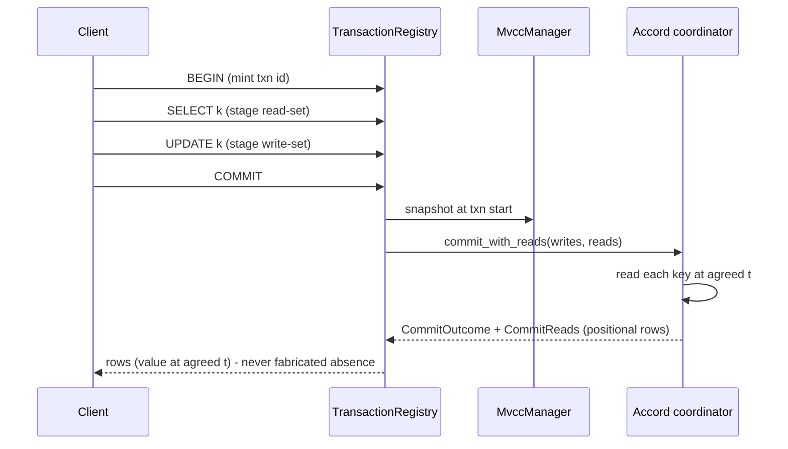

# Project Plan — Read-in-transaction

## Shippable outcomes

| Sprint | Outcome (what a user can do after it) | Gate |
|---|---|---|
| S1 | Both known concurrency defects tested at the level where each reproduces, RT-3 ISOLATED | RT-3: real-process reproducer WRITTEN and GREEN (3 nodes + wire, positive control passing), in-process fixture also GREEN (3/3) - neither reproduces it, so the OWED next step is LIVE re-verification on a healthy cluster (state artifact or not). RT-2: live probe (disjoint-key peers conflict; concurrency alone). RT-3 ISOLATED to the READ inside the transaction: blind writes survive concurrency, read-modify-writes lose the cell - so the read-in-transaction work (CQL `LET` + read-set validation) is ALSO the fix for a live data-loss bug, which raises it above a new-feature priority. |
| S2 | A transaction can `SELECT` and commit; the read returns the value at the transaction's agreed `t`, validated through Accord — and the read set it contributes is HYBRID (a keyed read registers the ROW it visited, a wide scan keeps the TABLE key) and STAGED, never a resident row collection | in-repo red at the engine seam, then green |
| S3 | Transactions with large read/write sets stay bounded in memory | measured flat peak-memory curve at stated N |
| S4 | Strict-serializability is CERTIFIED, not asserted | Elle `list-append`, `:valid? true`, live RF=3 + nemesis, no assumptions |

## Workstreams

| Workstream | Owner | Depends on | Parallel with |
|---|---|---|---|
| W1 tests for the two live concurrency defects (RT-2, RT-3) | implementer + verifier | live cluster up | - |
| W2 engine multi-key read-at-t on the Accord commit path | implementer (consensus path - do not rush) | W1 for the concurrency invariants | W3 |
| W3 bounded read-set (spill/stream), then commit streaming | implementer | W2's seam frozen | W2 |
| W4 PG front end: snapshot read inside a txn uses the same read path | implementer | W2 | W3 |
| W5 Elle list-append harness + certification run | verifier (distinct from W2's author) | W2, W3 | - |

## Progress

- **W2 (partial, landed): the absence-evidence half of the read set.** A transaction's scanned
  tables register a READ of each table's whole-table WRITE watermark
  (`POSTGRES_WRITE_TABLE_KEY_PREFIX`), and every table it WROTE registers that watermark, so a
  phantom INSERT by a writer that never scanned the table is refused instead of committed. A READ
  registration is distinguishable from a WRITE (`POSTGRES_READ_KEY_PREFIX` + `postgres_read_lookup_key`):
  read-read never conflicts, read-write does. Engine-seam red first:
  `quorum_availability::an_insert_into_a_table_a_scanner_read_is_refused`.
- **W2/W3 (landed): ROW granularity for a KEYED read, through the write-set spill.** A read that the
  front end's `point_read_row_key` judgement resolves to keys registers the ROW key it VISITED
  (`postgres_read_key`), so two keyed readers of DISJOINT rows of one table both commit while a
  concurrent writer of one of those rows still conflicts; a read that cannot be resolved to keys keeps
  the TABLE key and the per-table WRITE WATERMARK. The visited-row set is staged through the SAME
  threshold-plus-spill stage the write-set uses (`ferrosa-storage`'s `row_read_set`, one spill path,
  one tunable), so the read set's RESIDENT bytes are FLAT in the rows read — a resident row-key
  collection is FORBIDDEN on the fixed-4-GB path and is wired only as the gate's negative control.
  Engine seam: `row_read_set::tests::residency_is_flat_across_widely_separated_row_counts`. Transaction
  gate (the S3 shape, at the transaction): `ferrosa-postgres/tests/pg_full_scan_memory_bound.rs::keyed_read_set_residency_stays_flat_through_the_postgres_front_end`
  — real wire, `BEGIN ISOLATION LEVEL SERIALIZABLE` → N keyed reads → one write → `COMMIT` — SHOWN red
  under a resident read set (`33792` resident bytes at N=1024) and green under the staged one. Wired
  through `PgReadSet` (FMEA CL-72/CL-73, ST-WS-03, PG-17/PG-18). Owed (named):
  `accord/transaction_commit.rs` still materializes the row read keys in its own
  `resolve_inputs`/`write_set` vectors, bounded by the keyed read's key count.
- **W2 (NOT DONE): ROW granularity for a scan** (board t_b880d105). The unit is still the TABLE.
  A scan in this engine reads every row of the table, so a visited-ROW LIST read set would be
  unbounded — forbidden, node RAM is fixed at 4 GB — and bounding it to the rows a predicate MATCHES
  needs a predicate→range push-down the planner does not have. The remaining work is a bounded
  range / segment marker at the scanned boundaries, not a row list.

## Sequence diagram (intended commit path)

## Definition of done

1. Every FMEA item with RPN >= 50 maps to a test that fails before its fix.
2. A transaction that reports COMMIT leaves the VALUE written readable through a different
   session (no lost cell), and two simultaneous transactions on disjoint keys BOTH survive.
3. Memory stayed flat as read-set and write-set grew, measured at a stated N - the
   statement cap is not lifted before this holds.
4. Elle `list-append/check {:consistency-models [:strict-serializable]}` returns `:valid? true`
   against a live RF=3 cluster under a partition/slow nemesis, with no `:linearizable-keys?`
   assumption.
5. Crate docs updated for any crate whose behaviour or public API changed.

## Not in scope

- UDF/AssemblyScript aggregate surface (parked by the requester).
- Lifting `FERROSA_CQL_TRANSACTION_MAX_STATEMENTS` (REFUSED until a spilling write-set exists).
- Raising node memory. Every OOM in this area is fixed by removing materialization.
