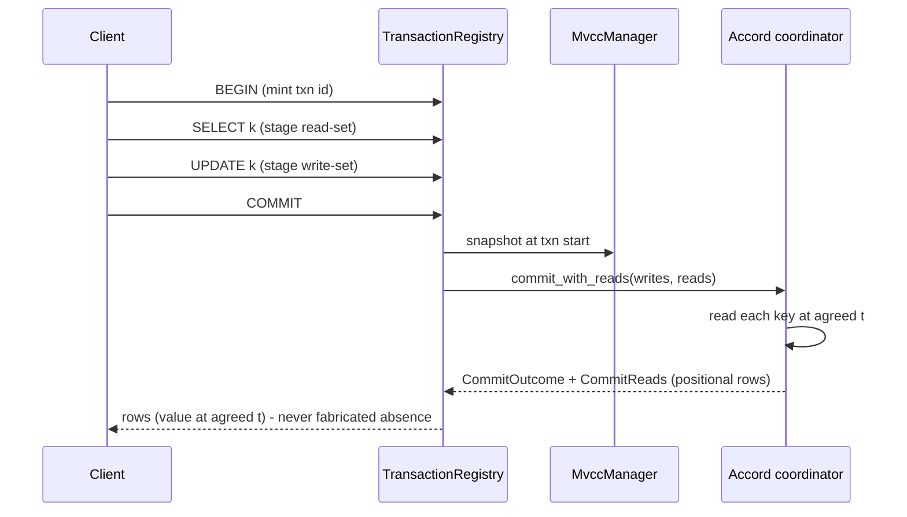

# Project Plan — Read-in-transaction

## Shippable outcomes

| Sprint | Outcome (what a user can do after it) | Gate |
|---|---|---|
| S1 | Two known concurrency defects are held down by failing-then-passing tests at the real entry point | tests exist and are RED before the fix |
| S2 | A transaction can `SELECT` and commit; the read returns the value at the transaction's agreed `t`, validated through Accord | in-repo red at the engine seam, then green |
| S3 | Transactions with large read/write sets stay bounded in memory | measured flat peak-memory curve at stated N |
| S4 | Strict-serializability is CERTIFIED, not asserted | Elle `list-append`, `:valid? true`, live RF=3 + nemesis, no assumptions |

## Workstreams

| Workstream | Owner | Depends on | Parallel with |
|---|---|---|---|
| W1 tests for the two live concurrency defects (RT-2, RT-3) | implementer + verifier | live cluster up | - |
| W2 engine multi-key read-at-t on the Accord commit path | implementer (consensus path - do not rush) | W1 for the concurrency invariants | W3 |
| W3 bounded read-set (spill/stream), then commit streaming | implementer | W2's seam frozen | W2 |
| W4 PG front end: snapshot read inside a txn uses the same read path | implementer | W2 | W3 |
| W5 Elle list-append harness + certification run | verifier (distinct from W2's author) | W2, W3 | - |

## Sequence diagram (intended commit path)

## Definition of done

1. Every FMEA item with RPN >= 50 maps to a test that fails before its fix.
2. A transaction that reports COMMIT leaves the VALUE written readable through a different
   session (no lost cell), and two simultaneous transactions on disjoint keys BOTH survive.
3. Memory stayed flat as read-set and write-set grew, measured at a stated N - the
   statement cap is not lifted before this holds.
4. Elle `list-append/check {:consistency-models [:strict-serializable]}` returns `:valid? true`
   against a live RF=3 cluster under a partition/slow nemesis, with no `:linearizable-keys?`
   assumption.
5. Crate docs updated for any crate whose behaviour or public API changed.

## Not in scope

- UDF/AssemblyScript aggregate surface (parked by the requester).
- Lifting `FERROSA_CQL_TRANSACTION_MAX_STATEMENTS` (REFUSED until a spilling write-set exists).
- Raising node memory. Every OOM in this area is fixed by removing materialization.
