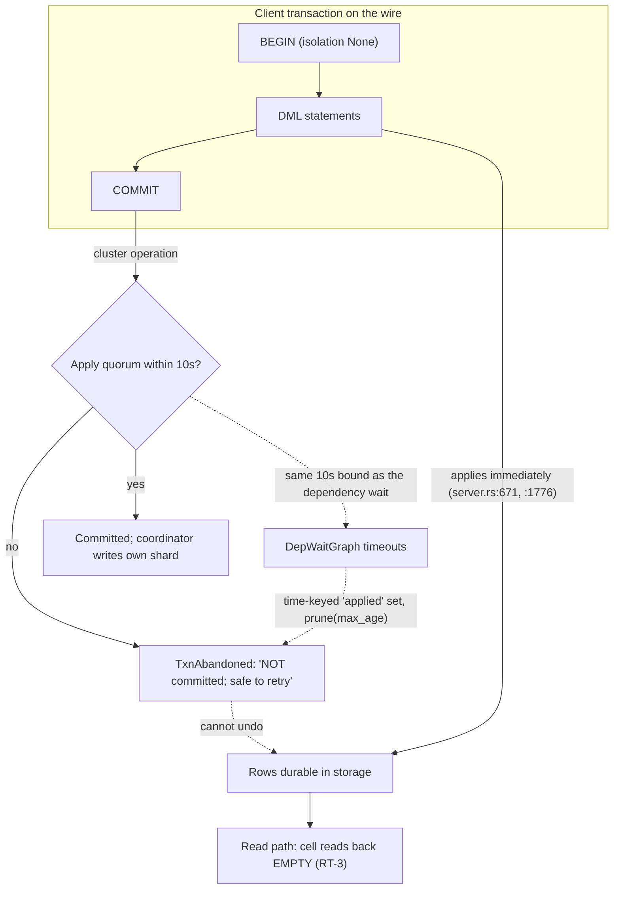

# Commit Path and Transaction Boundary — Architecture Review

> Last updated: 2026-10-12
> Status: Draft (findings; forces a decision)
> Scope: `ferrosa-cluster::accord` commit/apply/dep-wait, `ferrosa-postgres` transaction handling
> Method: `/architect review` — memory-first, git-hotspot triage, then evidence-classed code reading

## Overview

Three live defects were reported against the PostgreSQL front end, hypothesised to be one family:
a transaction that aborting leaves data behind, a transaction that aborts intermittently, and a
successfully committed read-modify-write whose committed cell reads back empty.

This review covers the commit and transaction logic, the buffers that carry a transaction's state,
and the data structures that track transactions in flight. It does **not** propose fixes; it
establishes the mechanism, separates proven evidence from hypothesis, and names the decision the
findings force.

## Method note (why the reading is trustworthy)

- **Memory-first** (`ferrosa-memory.hybrid_search`) — surfaced prior art: ADR-021 (`write_path` as the
  Accord transaction boundary), the storage data-flow's "durable by the commit log first, then applied
  to the memtable", and a proposed Unified Transaction Manager. Retrieval reported
  `native content indexes unavailable`, so absence of further hits is a store limitation, not evidence.
- **Hotspot triage** (1 year, commit/apply/dep-wait paths):

  | File | Commits | Bug-fix commits |
  |------|---------|-----------------|
  | `accord/coordinator.rs` | 71 | 67 |
  | `accord/state_machine.rs` | 43 | 38 |
  | `accord/apply.rs` | 38 | 30 |
  | `accord/handlers.rs` | 30 | 26 |
  | `accord/transaction_commit.rs` | 14 | 13 |

  The commit path is simultaneously the highest-churn and highest-bug-fix area in the crate. Both
  halves of that pairing are present, which is the definition of an architectural risk rather than a
  maintenance annoyance.

## Stated design intent (owner-supplied — distinct evidence class)

The owner states the intended architecture for the transaction buffer, and it is **not** a
front-end buffer:

- **The MVCC system IS the concurrency buffer.** It is intended to track the changes a transaction
  will apply, and to be **empty when no transaction is in flight**.
- **It is the spill-to-disk for transactions.** Large transactional write-sets belong *inside* this
  buffer (which spills), not in a separate structure beside it.
- **Changes are applied at COMMIT time**, from that buffer.

This is the intent the implementation is measured against below. Where the code diverges, the
finding is recorded against this intent — the buffer layer is intended to be MVCC, so a fix that
adds buffering somewhere else is a second implementation of an existing design, not a repair of it.

## Findings

Evidence classes: **proven** = readable from source as written; **observed** = seen in live runs;
**hypothesis** = plausible, not yet confirmed by probe.

### F1 — The wire transaction boundary is not the engine's durability boundary (proven + observed)

`accord/coordinator.rs:2783-2799` returns `TxnAbandoned` only when the Apply quorum was **not** met.
The code comments are explicit that before that quorum "NO replica has applied, so an abandon is
truthful and leaves nothing behind", and the ordering that guarantees it (secure the Apply quorum
*before* the coordinator writes its own shard, lines 2755-2771) is present.

Yet the observed run — a `pgbench -i` whose `commit` was abandoned at the bound — left
**669,315 of 1,000,000 rows** durably readable in the table census immediately afterwards
(`PGI10`/probe census `669315|64|7`).

The only reading consistent with both facts: those rows were made durable **before** the abandon
decision, by a path other than the abandoned transaction's apply phase.

Two source facts explain which path:

- `ferrosa-postgres/src/server.rs:671` and `:1776` — "applies immediately"; "MVCC at COMMIT;
  autocommit (no open txn) applies immediately."
- A plain `BEGIN` stores isolation `None`, so the statement-level path does not treat it as a
  tracked transaction (observed during the CQL/SQL client handoff).

**Consequence.** A client's `BEGIN; DML; COMMIT;` can apply its DML immediately while the COMMIT is
still a cluster operation whose outcome is decided later. A failed COMMIT therefore cannot roll back
what is already durable, and "NOT committed; safe to retry" is not true of the data. This is the
reported "an abort that leaves data".

**Stated against the intended design.** The MVCC layer was intended to be the concurrency buffer —
holding a transaction's changes until COMMIT and empty otherwise. The statement path **bypasses that
buffer** and applies immediately, so the buffer is never the owner of an in-flight transaction's
changes. The repair is therefore to **route a transaction's writes into the MVCC concurrency buffer
and apply from it at COMMIT** — reusing the layer designed for the purpose (and its transactional
spill) rather than adding a second buffer elsewhere. The CQL path's existing behaviour (buffering
`INSERT`/`UPDATE`/`DELETE` until COMMIT) is the precedent inside this same codebase.

### F2 — One wall-clock constant decides outcomes for three distinct waits (proven)

`accord/dep_wait.rs:25` defines `DEP_WAIT_TIMEOUT: Duration = Duration::from_secs(10)`, documented as
"if a transaction waits longer than 10 seconds for a dependency, it is aborted with a timeout error."

The same `bound` value is threaded through at least three semantically different waits in
`coordinator.rs`: the Apply-quorum broadcast (`:2745`, `:2751`), the local-applied wait (`:2722`), and
the dependency wait itself. A timer expiry in any of them is converted into a **client-visible
transactional outcome** (`TxnAbandoned`, `:2799`).

The tree already contains the evidence that this is a symptom channel rather than a correct
detector: the CL-28 FMEA entry records that a genuine dependency cycle "surfaced only as the 5 s
dependency-wait failure", after "cost[ing] three agents hours chasing a connect-timeout theory and
then a queueing theory". A bound that fires for slow-but-progressing transactions as readily as for a
real deadlock cannot distinguish them.

**Consequence.** Under load, the abandon fires on transactions that were merely slow. Whether a given
million-row commit aborts is then a race — which matches the observed intermittency directly: the
same build and cluster committed an identical million-row transaction cleanly twice standalone
(53.25 s and ~100 s runs) and abandoned the same shape inside the probe minutes later.

### F3 — Correctness keyed on time where identity is required (proven, in the code's own words; LIVE call site located)

`DepWaitGraph` holds `applied: HashMap<TxnId, Instant>` and `aborted: HashMap<TxnId, Instant>`, pruned
by `prune(max_age)` (`dep_wait.rs:309-318`). `register_wait` **consults** that set for correctness:

```rust
if self.applied.contains_key(&dep) { return Ok(()); }
```

`forget()` (`:320-345`) was added precisely because age-keyed pruning is unsafe here, and its
doc-comment states the failure:

> "an AGE bound applied to the graph alone can forget a dependency whose `TxnState` is still live ...
> so the waiter registers on it, is never woken (it was already marked applied), and parks until its
> own bound expires and is abandoned — the liveness failure the apply path already fixed once.
> **The state is the right key, not the clock.**"

**Consequence.** The architecture currently keys an applied-dependency decision on elapsed time while
knowing, in writing, that the correct key is transaction identity. The identity-keyed path (`forget`)
exists alongside the clock-keyed path (`prune`) rather than replacing it.

### F4 — Tracked state is spread across hand-synchronised structures (proven)

A transaction in flight is tracked by, at minimum: `waiting_on` and `waited_by` (two maps that must be
updated in lockstep), `wait_start`, `applied`, `aborted`; plus the state machine's `TxnState`, the
applier's idempotency sets (CL-61), and the PostgreSQL-side metadata.

Six mutators (`register_wait`, `mark_applied`, `clear_waits`, `waive`, `break_cycle`, `forget`) each
maintain the two edge maps by hand. CL-28's residual is the tell: a `CycleDetected` result was
**swallowed** by `let _ =`, so an index inconsistency did not surface as a graph error — it surfaced
as a *timeout*, indistinguishable from slowness. Where correctness depends on N structures staying
mutually consistent, a missed update is not a crash; it is a delayed, misattributed abort.

**Consequence.** This is the reported "not tracking its data correctly" — accurately, if the
mechanism is read as *no single durable record owns the truth*, rather than as one wrong container.

### F5 — The reported third defect is consistent with the same root (hypothesis)

RT-3: a read-modify-write transaction reports success and its committed cell reads back **empty**,
while a blind write in the same run keeps its value (settled-cluster probe, reproduced; the read
inside the transaction is the discriminator). If a transaction's writes can be durable while its
version/visibility bookkeeping is not (F1), a reader can legitimately fail to observe a value the
writer believes it committed. **Not proven**; the decisive experiment is named below.

## Hypothesis adjudication

The reported hypothesis was that the three defects are one family, an abort that leaves data meaning
"it isn't tracking its data correctly", and an intermittent abort meaning "a poor data structure".

**Partly confirmed, and sharpenable.** The defects are one family, but the common root is not a
container choice. It is that **no single durable, identity-keyed transaction record owns the truth**,
so each path reconstructs what it needs from structures it must keep in sync (F4) or bounds by a clock
it trusts (F2, F3) — while the write path can make data durable outside the transaction whose fate is
still undecided (F1). The maps are the symptom; the missing record is the cause.

## Diagram



## Open questions

- [ ] **Decisive experiment for F1.** `BEGIN; INSERT (3 rows); COMMIT;` over the real wire with the
      COMMIT forced to fail — do the three rows survive? A point lookup of a known key asserted
      present after a reported abandon settles F1 without inference. (Never a count: a partial write
      preserves a count.)
- [ ] Does `prune(max_age)` still have a production caller after the `forget()` change, or does only
      the identity-keyed path run? A bounded grep settles it.
- [ ] Is RT-3 the same root as F1, or a distinct read-path visibility defect? The discriminator is
      already known: read-modify-write loses, blind write keeps.
- [ ] Which of the six mutators has ever been observed to leave the two edge maps inconsistent?
      Instrument, or prove by exhaustive state-space test, before claiming any one path.

## Related specs

- [ADR-021](../decisions/021-*.md) — `write_path` as the Accord transaction / replica-resolution boundary
- [ADR-023](../decisions/023-read-in-transaction-mvcc.md) — read-in-transaction MVCC
- `ferrosa-cluster/specs/fmea.md` — CL-28 (crossing dependencies), CL-60 (abandon durability), CL-61
  (applied-set growth)
- `ferrosa-postgres/specs/` — MVCC snapshot and read-set plumbing
