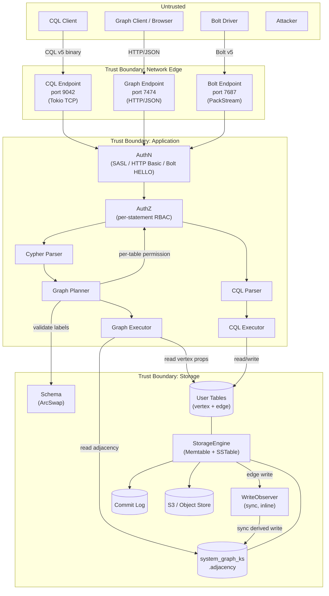

# Threat Model — ferrosa-graph Extensions

> **Date:** 2026-03-12
> **Last revised:** 2026-10-15
> **Scope:** New attack surface introduced by the graph query endpoint (ferrosa-graph)
> **Methodology:** STRIDE per element
> **Design Spec:** `superpowers/specs/2026-03-12-ferrosa-graph-design.md`

> **Revision note (2026-10-15).** Every control and bound named below was
> re-checked against the crate at v0.22.3 (`origin/main`, `9e32e82a`). Status
> lines now cite the code that implements, contradicts, or does not address the
> control. Where an earlier claim here is contradicted by the code, the
> contradiction is recorded under *Findings from the 2026-10-15 review* and
> carried as an **Open Question** — it is not resolved by assumption. The
> original threat descriptions and design-intent mitigations are preserved; only
> the *Status* field and the risk summary have been corrected to describe what
> the code does today.

## System Overview

ferrosa-graph adds a Cypher/GQL query endpoint alongside CQL. Key new components:

- **HTTP/JSON endpoint** (default `127.0.0.1:7474`) — network-facing service; routes `/graph/query`, `/graph/explain`, `/graph/schema`, `/graph/subscribe`, `/graph/unsubscribe`, `/graph/cdc/page`, plus unauthenticated `/graph/health`.
- **Bolt v5 TCP endpoint** (default `127.0.0.1:7687`) — Neo4j-driver compatibility listener over PackStream (`bolt/server.rs`).
- **Cypher parser** — input parsing surface accepting arbitrary user text.
- **Adjacency index** — system-managed table `system_graph_<keyspace>.adjacency` maintained by a **synchronous** write observer.
- **AdjacencyIndexObserver** — `WriteObserver` hook in the storage write path generating derived mutations (`ObserverMode::Sync`, `adjacency/observer.rs:41`).
- **Table extensions** — metadata annotations (`graph.type`, `graph.source`, `graph.target`, `graph.*_label`) controlling graph behavior.
- **Dual-access model** — same data accessible via CQL (port 9042), Cypher (port 7474), and Bolt (port 7687).

## Data Flow Diagram

## Assets

| Asset | Type | Impact if Compromised |
|-------|------|----------------------|
| Graph data (vertices, edges, properties) | Confidentiality, Integrity | Data breach, incorrect query results |
| Adjacency index | Integrity, Availability | Incorrect traversals, missing edges, graph corruption |
| Table extensions metadata | Integrity | Attacker controls which tables are treated as graph edges |
| Authentication credentials | Confidentiality | Full system access via CQL, graph HTTP, or Bolt |
| Audit trail | Integrity | Actions via graph endpoint untracked |
| System availability | Availability | Graph queries or observer work degrades CQL |
| S3-stored SSTables | Confidentiality, Integrity | Long-term data exposure if adjacency index leaks |

## Design boundaries and controls (verified 2026-10-15)

These are the controls the code actually enforces at this revision. Each is
cited to the code that implements it; the per-threat sections below reference
them.

- **B1 — Authentication precedes storage I/O.** All graph HTTP routes except
  `/graph/health` and `/health` run behind `auth_middleware`; the durable CDC
  replay route is deliberately behind the same middleware so commit-log replay
  cannot open before authentication (`http.rs:999-1022`, `http.rs:835-844`).
  When `auth_disabled` is set the middleware injects a superuser context and
  skips credential validation — same behaviour as the CQL path
  (`http.rs:213-227`).
- **B2 — Per-statement, per-table authorization at the logical planner.**
  `validate` derives the required permission from the statement
  (`Permission::Select` for reads/subscribe, `Permission::Modify` for
  writes; `planner/logical.rs:118-140`) and `resolve_pattern_labels` walks every
  node label and every relationship-type label in the pattern, calling
  `check_table_permission` for each (`planner/logical.rs:103-116`,
  `planner/logical.rs:258-304`). Authorization is per statement class, not
  per-label or per-property (see G-5 in the crate FMEA).
- **B3 — Rate-limited authentication.** HTTP Basic auth delegates to
  `Schema::authenticate`, which checks the auth rate limiter before hashing
  (`ferrosa-schema/src/registry.rs:889-891`).
- **B4 — Bounded request bodies and panic containment on the HTTP router.**
  `start_graph_http` wraps the router in `CatchPanicLayer` and
  `RequestBodyLimitLayer` (`http.rs:1031-1033`); default body cap 1 MB
  (`http.rs:60-72`), CDC page cap 64 KiB (`http.rs:846`).
- **B5 — Sanitized error responses.** `error_to_response` maps typed errors to
  400/403/408/409/500/503 and never exposes storage/schema/internal detail
  (`http.rs:177-205`).
- **B6 — Transport encryption policy.** TLS is resolved through the shared
  `ferrosa_net::tls` builder; `require_tls` without a certificate is an error,
  never a silent plaintext fallback (`http.rs:1042-1053`). Production startup
  validation requires TLS on the graph HTTP and Bolt listeners when the graph
  engine is enabled (`ferrosa/src/main.rs:1065-1106`).
- **B7 — DoS bounds on the executor and Bolt codec.** `GraphEngineConfig`
  defaults: `query_timeout` 30 s, `max_fan_out_per_hop` 10 000, `max_groups`
  100 000, `max_collect_size` 10 000, `max_var_path_visited` 100 000,
  `spill_threshold_bytes` 64 MiB (`executor/expand.rs:115-131`); variable-length
  hops are hard-capped at `MAX_VAR_HOPS = 10` in the physical planner
  (`planner/physical.rs:143`, `planner/physical.rs:1488`); PackStream nesting is
  capped at `MAX_NESTING_DEPTH = 128` before authentication
  (`bolt/codec.rs:259`, `bolt/codec.rs:441-453`).
- **B8 — Loopback default binds.** Graph HTTP (`127.0.0.1:7474`,
  `http.rs:64-72`) and Bolt (`127.0.0.1:7687`, `bolt/server.rs:41-52`) bind
  loopback by default; exposing either to a wider address is an explicit
  operator choice.
- **B9 — MERGE key-column schema contract.** A schema-unaware `MERGE` that sets
  *some but not all* of its backing table's key columns (partition key ∪
  clustering key) is refused with a `Validation` error naming the table
  (`executor/expand.rs:4059-4065`; guard
  `schema_merge_requires_hidden_key_resolution`, `executor/expand.rs:4956-5029`).
  A MERGE that sets none (the schema can infer the full key) or that sets all
  (the caller supplies the full key) is allowed. This is an
  authorization-adjacent schema-contract control: an external client writing
  vertices/edges through Cypher must supply every key column or the write is
  refused, so a partial key cannot silently collapse rows onto a wrong key.

## Threat Inventory

### T1: Cypher Injection / Parser Exploitation

| Field | Value |
|-------|-------|
| **STRIDE** | Tampering, Elevation of Privilege |
| **Component** | Cypher parser (parser.rs) |
| **Threat** | Malformed Cypher input causes parser panic, stack overflow (deeply nested expressions), or unexpected AST that bypasses planner validation |
| **Likelihood** | 2 — Parser accepts arbitrary user text; hand-rolled parsers are error-prone |
| **Impact** | 2 — Panic crashes the connection task; crafted AST could bypass authorization |
| **Risk** | **4 (High)** |
| **Mitigation** | (1) Proptest fuzz testing on all parser entry points (already in plan). (2) Limit expression nesting depth (max 64 levels) to prevent stack overflow. (3) Catch panics at the HTTP handler boundary (tokio task). (4) Parser produces AST only — planner validates against schema before execution. |
| **Status** | **Mitigated.** Expression nesting capped at `MAX_EXPR_DEPTH = 64` (returns a parse error naming the limit; `parser/parse_impl.rs:6-16`, `45-52`). HTTP boundary panic containment is now present via `CatchPanicLayer` (`http.rs:1031-1033`) — the previous "Phase 1" remainder is closed. Planner validates labels/columns against the schema before execution. |

### T2: Unauthenticated Graph Endpoint Access

| Field | Value |
|-------|-------|
| **STRIDE** | Spoofing |
| **Component** | HTTP endpoint (http.rs) |
| **Threat** | Graph HTTP endpoint lacks authentication, allowing unauthenticated queries. CQL uses SASL handshake; HTTP has no equivalent unless explicitly implemented. |
| **Likelihood** | 3 — If auth is not implemented on the HTTP endpoint, it's trivially exploitable |
| **Impact** | 3 — Full read/write access to all graph data |
| **Risk** | **9 (Critical)** |
| **Mitigation** | (1) HTTP endpoint MUST authenticate before processing queries. Use HTTP Basic Auth or Bearer token mapped to the same RBAC system (ferrosa-schema AuthContext). (2) Reuse the same `Schema::authenticate()` with rate limiting. (3) Never ship an unauthenticated endpoint, even in dev mode — use a dev token. |
| **Status** | **Mitigated (boundary B1, B3).** HTTP Basic auth middleware (`auth_middleware`, `http.rs:213-304`) maps to `Schema::authenticate()` (rate-limited, `registry.rs:889-891`); every route except `/graph/health` (and its `/health` alias) requires auth (`http.rs:999-1022`). **Operator risk:** `auth_disabled` short-circuits credential validation to a superuser context (`http.rs:220-227`) — the same kill-switch as CQL, which must be operator-guarded (see crate FMEA FE-3 in `ferrosa/specs/fmea.md`). |

### T3: Authorization Bypass via Graph Endpoint

| Field | Value |
|-------|-------|
| **STRIDE** | Elevation of Privilege |
| **Component** | Graph executor, planner |
| **Threat** | A user with CQL SELECT on `graph.person` but NOT on `graph.company` uses a Cypher traversal `MATCH (a:Person)-[:WORKS_AT]->(c:Company) RETURN c.name` to read Company data they shouldn't access. The graph executor must enforce per-table permissions at each hop. |
| **Likelihood** | 2 — If per-hop auth checking is missed, traversals leak data across permission boundaries |
| **Impact** | 3 — Unauthorized data access across tables |
| **Risk** | **6 (High)** |
| **Mitigation** | (1) Executor MUST check `Permission::Select` on each vertex/edge table accessed during traversal — not just the anchor table. (2) Planner should pre-check all tables in the pattern at plan time and fail fast. (3) Adjacency index reads should also check permission on the referenced `edge_table`. |
| **Status** | **Mitigated at plan time (boundary B2).** The logical planner resolves every node label and relationship-type label in the pattern and checks the statement's permission on each table before execution (`planner/logical.rs:258-304`). Authorization is per statement class (Select/Modify), not per label/edge-type or per property. |

### T4: Denial of Service via Expensive Graph Queries

| Field | Value |
|-------|-------|
| **STRIDE** | Denial of Service |
| **Component** | Graph executor (expand.rs) |
| **Threat** | Unbounded graph traversals exhaust memory or CPU. Examples: (a) `MATCH (a)-[:FOLLOWS]->() RETURN a` on a social graph with a supernode (millions of edges). (b) Multi-hop expansion without LIMIT produces cartesian blowup. (c) No query timeout — long-running traversals block executor threads. |
| **Likelihood** | 3 — Trivial to craft; even well-meaning queries can be expensive |
| **Impact** | 2 — Degrades both graph AND CQL performance (shared StorageEngine) |
| **Risk** | **6 (High)** |
| **Mitigation** | (1) Default query timeout (e.g., 30 seconds). (2) Max result set size (e.g., 10,000 rows default). (3) Max expansion fan-out per hop (configurable). (4) Query memory budget tracking. (5) Separate thread pool or Tokio task budget for graph queries so CQL is not starved. |
| **Status** | **Partially mitigated (boundary B7).** Query timeout defaults to 30 s and per-hop fan-out is capped at 10 000 (`executor/expand.rs:118-125`); aggregation is bounded by `max_groups` 100 000 and `max_collect_size` 10 000. **Contradiction — "max result set size" is no longer an enforced control:** `max_result_rows` is deprecated and the executor explicitly does NOT truncate on it (a test asserts no executor path truncates; `executor/expand.rs:92-97`, `executor/expand.rs:6729-6764`). The doc's mitigation (2) therefore no longer holds. **Remaining:** no per-query memory budget and no separate task pool for graph work (see *Remaining follow-on*). |

### T5: Adjacency Index Inconsistency (Consistency Window)

| Field | Value |
|-------|-------|
| **STRIDE** | Tampering, Information Disclosure |
| **Component** | AdjacencyIndexObserver (observer.rs) |
| **Threat** | The write observer creates a window where edge data exists in the edge table but not yet in the adjacency index. During this window: (a) Cypher queries miss recently written edges. (b) DELETE removes the edge but adjacency index still has the entry — phantom edges. (c) Observer crash/restart could leave permanent inconsistency. |
| **Likelihood** | 2 — Crash scenarios are realistic |
| **Impact** | 2 — Incorrect query results; phantom edges could leak data that was "deleted" |
| **Risk** | **4 (High)** |
| **Mitigation** | (1) Observer mutations go through the commit log for crash recovery. (2) Periodic background reconciliation job compares edge tables against adjacency index. (3) `DELETE` tombstones in the adjacency index must have timestamps ≥ the edge deletion. (4) Document the consistency model clearly for users. (5) Consider a "consistency check" graph query (`EXPLAIN CONSISTENCY`). |
| **Status** | **Mitigated for the crash/reconcile cases; one narrow race remains.** The observer runs `ObserverMode::Sync` (`adjacency/observer.rs:41-42`), so the index normally commits with the edge — the async window described above no longer applies at rest. `adjacency/reconcile.rs` is a full two-phase row-level reconciler (edge scan + orphan cleanup, streamed partition-by-partition, `reconcile.rs:266-408`), not the count-only stub the earlier status described; failures increment `ReconcileMetrics::errors` and mark the pass incomplete (`reconcile.rs:40-50`, `231`, `275`, `298`, `384`, `401`). A per-keyspace first-use heal runs before the first traversal and refuses a query retryably (`GraphError::Unavailable`, HTTP 503) if it cannot complete (`engine.rs:851-875`). **Remaining (crate FMEA G-6):** orphan tombstoning does not take a snapshot/lock, so a narrow TOCTOU window with a concurrent edge create persists. |

### T6: Table Extension Metadata Poisoning

| Field | Value |
|-------|-------|
| **STRIDE** | Tampering, Elevation of Privilege |
| **Component** | ferrosa-schema (table extensions) |
| **Threat** | A user with ALTER TABLE permission sets `graph.type = 'edge'` and `graph.source = 'src_id'` on a table they control, causing the WriteObserver to generate adjacency index entries for their table. This could: (a) Pollute the adjacency index with attacker-controlled edges. (b) Create edges that point to vertices in tables the attacker can't normally read. |
| **Likelihood** | 2 — Requires ALTER TABLE permission, but that's a common grant |
| **Impact** | 2 — Adjacency index pollution, possible data leakage via graph traversals |
| **Risk** | **4 (High)** |
| **Mitigation** | (1) Setting `graph.*` extensions requires a new `Permission::GraphAdmin` or at minimum `Permission::Create` on the keyspace (not just ALTER on the table). (2) Validate that `graph.source_label` and `graph.target_label` reference existing vertex tables in the same keyspace. (3) Audit `graph.*` extension changes as a distinct event type. |
| **Status** | **Mitigated.** `validate_graph_extensions` requires `Permission::Create` on the keyspace for any `graph.*` key, validates `graph.type ∈ {vertex, edge}`, requires source/target/source_label/target_label for edge tables, and confirms source/target columns and the referenced vertex tables exist in the same keyspace (`ferrosa-schema/src/registry.rs:1063-1155`). Applied on CREATE and ALTER (`registry.rs:1283-1284`, `1360-1362`). Note: extension changes still emit the generic `TableAltered` audit event, not a distinct `graph.*` event type — mitigation (3) is not implemented as a distinct event. |

### T7: Cross-Protocol Data Leakage

| Field | Value |
|-------|-------|
| **STRIDE** | Information Disclosure |
| **Component** | Dual-access model |
| **Threat** | The adjacency index is a system table. If readable via CQL, any user with access to its keyspace can enumerate all edges in the graph, bypassing per-table permissions. The adjacency index stores enough to reconstruct graph structure without accessing the actual edge/vertex tables. |
| **Likelihood** | 2 — System keyspaces are often granted broader access |
| **Impact** | 2 — Graph structure leak even for users without edge table access |
| **Risk** | **4 (High)** |
| **Mitigation** | (1) The adjacency table must be protected: CQL SELECT on it requires the same permissions as on the underlying edge tables. (2) Or: make its keyspace completely inaccessible via CQL (internal-only). (3) The adjacency index should not store edge properties — only vertex IDs and table references. |
| **Status** | **Mitigated, with drift in the doc's naming.** The table is created with `is_system: true` (`adjacency/schema.rs:132`) so DROP/ALTER are refused with `SystemTableProtected` (`registry.rs:1331-1336`, `1404-1409`); CQL access follows standard permission checks (mitigation 1). **Drift:** the keyspace is per-user-keyspace `system_graph_<keyspace>.adjacency` (`adjacency/schema.rs:49-50`), not `system_graph`; and `is_system_keyspace()` does **not** recognise the `system_graph_*` prefix (`registry.rs:2106-2117`), so keyspace-level "system" treatment does not apply and the protection rests entirely on the per-table `is_system` flag. Mitigation (2) (internal-only keyspace) is not implemented. |

### T8: HTTP Response Information Disclosure

| Field | Value |
|-------|-------|
| **STRIDE** | Information Disclosure |
| **Component** | HTTP endpoint (http.rs) |
| **Threat** | Error responses from the graph endpoint leak internal details: stack traces, table names, file paths, schema structure, Rust panic messages. |
| **Likelihood** | 2 — Common in HTTP APIs without explicit error sanitization |
| **Impact** | 1 — Information aids further attacks but is not directly exploitable |
| **Risk** | **2 (Medium)** |
| **Mitigation** | (1) Return generic error messages to clients; log details server-side. (2) Never expose Rust panic backtraces in HTTP responses. (3) Parse errors should show the query position but not internal parser state. |
| **Status** | **Mitigated (boundary B5).** `error_to_response` maps typed errors to HTTP statuses and sanitizes storage/schema/internal detail to a fixed `Internal server error` (`http.rs:177-205`). Parse errors expose only the byte offset and message. `CatchPanicLayer` prevents panic backtraces reaching clients (`http.rs:1031-1033`). **Status set is broader than earlier documented:** the handler now also returns 409 (constraint violation) and 503 (retryable `Unavailable`), alongside 400/403/408/500. |

### T9: WriteObserver Amplification Attack

| Field | Value |
|-------|-------|
| **STRIDE** | Denial of Service |
| **Component** | WriteObserver, StorageEngine |
| **Threat** | A user bulk-inserts into an edge table, triggering the WriteObserver for every row. Each edge write generates 2 adjacency mutations (OUT + IN). A batch of 1M edge inserts generates 2M observer writes, potentially overwhelming the storage engine or commit log. The observer shares the same StorageEngine as CQL. |
| **Likelihood** | 2 — Bulk loads are normal operations |
| **Impact** | 2 — Observer backlog degrades all storage operations |
| **Risk** | **4 (High)** |
| **Mitigation** | (1) Observer write queue with bounded capacity and backpressure. (2) Rate-limit observer mutations (e.g., max 10K/sec per table). (3) Batch observer mutations (accumulate for 10ms, write as batch). (4) Monitor observer queue depth as a health metric. |
| **Status** | **Design basis changed — see finding.** The adjacency observer runs `ObserverMode::Sync` (`adjacency/observer.rs:41-42`), so there is no per-row queue in the graph path: each edge write blocks the write path until its OUT/IN mutations are produced inline. The bounded `mpsc` channel and backpressure described here belong to `ObserverMode::Async` in ferrosa-storage (`ferrosa-storage/src/engine.rs:8524-8533`, `ferrosa-storage/src/observer.rs:22-25`) and are not what the graph observer uses. The amplification cost is now paid as inline write latency, not as an unbounded backlog; mitigations (2)–(4) (rate limit, batching, queue-depth metric) are **not implemented** for the graph observer. |

### T10: Audit Gap on Graph Operations

| Field | Value |
|-------|-------|
| **STRIDE** | Repudiation |
| **Component** | GraphEngine, HTTP endpoint |
| **Threat** | Graph read queries (MATCH) and write operations (CREATE/SET/DELETE via Cypher) are not audited. An attacker performs actions via the graph endpoint that don't appear in the audit log. CQL has comprehensive audit events; graph operations should too. |
| **Likelihood** | 3 — If audit events are not implemented for the graph endpoint, there's a 100% gap |
| **Impact** | 2 — Compliance failure, inability to trace data access |
| **Risk** | **6 (High)** |
| **Mitigation** | (1) Graph DDL operations should emit existing `TableCreated`/`TableAltered` audit events (they go through Schema). (2) Add new audit event types: `GraphQueryExecuted { query, keyspace, actor }`, `GraphMutationExecuted { query, keyspace, actor, vertices_affected, edges_affected }`. (3) Log source IP from HTTP connection. |
| **Status** | **Contradicted at this revision — see finding.** The event *variants* exist (`GraphQueryExecuted`, `GraphMutationExecuted` in `ferrosa-schema/src/audit/event.rs:81-95`) and Schema DDL emits `TableCreated`/`TableAltered`, so mitigation (1) holds. But no code in `ferrosa-graph` constructs or emits `GraphQueryExecuted`/`GraphMutationExecuted`: the HTTP handler only emits structured `tracing::info!` logs (`http.rs:345-351`, `384-391`, `402-408`). Source IP is not logged (mitigation 3). The graph query/mutation path is therefore not in the audit trail, only in logs. |

### T11: Unencrypted HTTP Transport

| Field | Value |
|-------|-------|
| **STRIDE** | Information Disclosure, Tampering |
| **Component** | HTTP endpoint |
| **Threat** | Graph endpoint serves plain HTTP. Credentials (Basic auth) and query results travel in cleartext. Network observers can read graph data and steal credentials. |
| **Likelihood** | 2 — Depends on deployment; internal networks may be less exposed |
| **Impact** | 3 — Credential theft + data leakage |
| **Risk** | **6 (High)** |
| **Mitigation** | (1) Support TLS on the HTTP endpoint (shared TLS config with CQL). (2) Production mode (DeploymentMode::Production) should reject unencrypted HTTP. (3) Development mode can allow plaintext with a warning. |
| **Status** | **Mitigated (boundary B6).** TLS is resolved through the shared `ferrosa_net::tls` builder; `require_tls` without a certificate is an error (`http.rs:1042-1053`). Production startup validation requires TLS on the graph HTTP and Bolt listeners when the graph engine is enabled (`ferrosa/src/main.rs:1065-1106`). **Nuance:** with the graph engine disabled the graph port serves only a fixed 503 stub and is not production-gated for TLS (`main.rs:1061-1064`). |

### T12: SUBSCRIBE Resource Exhaustion

| Field | Value |
|-------|-------|
| **STRIDE** | Denial of Service |
| **Component** | SUBSCRIBE executor, SSE endpoint |
| **Threat** | Attacker opens many SUBSCRIBE streams, each spawning a background re-query task. Unbounded subscriptions exhaust memory and executor threads. |
| **Likelihood** | 2 — Requires authenticated access but trivial to exploit |
| **Impact** | 2 — Degrades graph+CQL performance |
| **Risk** | **4 (High)** |
| **Mitigation** | (1) Per-connection subscription limit (e.g., 8, matching CQL). (2) Global subscription limit. (3) Subscription timeout/TTL. (4) Subscription registry with cleanup on disconnect. |
| **Status** | **Partially mitigated, and the scope is narrower than claimed — see finding.** Per-connection limit is implemented: `SubscriptionRegistry` refuses registration past the cap and cancels the would-be task (`executor/subscribe.rs:45-58`), default 8 via `FERROSA_GRAPH_MAX_SUBSCRIPTIONS` (`engine.rs:441-452`); `cancel_all`/`Drop` clean up on disconnect (`subscribe.rs:86-101`). **A global subscription limit (mitigation 2) is not implemented** — the registry bounds only per-connection. No subscription TTL (mitigation 3). |

### T13: Variable-Length Path Explosion

| Field | Value |
|-------|-------|
| **STRIDE** | Denial of Service |
| **Component** | Variable-length path executor |
| **Threat** | `MATCH (a)-[*1..100]->(b)` on a dense graph produces exponential expansion. Even with per-hop fan-out limits, total work is `fan_out^max_hops`. |
| **Likelihood** | 3 — Trivial to craft |
| **Impact** | 3 — Memory exhaustion, CQL starvation |
| **Risk** | **9 (Critical)** |
| **Mitigation** | (1) Hard cap on max hops (e.g., 10). (2) Total visited-vertex budget (not just per-hop). (3) Existing query timeout applies. (4) BFS with cycle detection (visited set prevents infinite loops). |
| **Status** | **Mitigated (boundary B7).** All four mitigations are implemented: `MAX_VAR_HOPS = 10` clamps the planner (`planner/physical.rs:143`, `1488`); `max_var_path_visited` defaults to 100 000 (`executor/expand.rs:112`, `128`); the query timeout applies; BFS carries a visited set with cycle detection (`executor/varpath.rs`). This threat was previously carried as *Open*; that status is stale. |

### T14: Aggregation Memory Amplification

| Field | Value |
|-------|-------|
| **STRIDE** | Denial of Service |
| **Component** | Aggregation executor |
| **Threat** | `collect()` aggregation on a large result set materializes all values in memory. High-cardinality GROUP BY creates many accumulator instances. |
| **Likelihood** | 2 — Requires crafted query on large dataset |
| **Impact** | 2 — OOM or degraded performance |
| **Risk** | **4 (High)** |
| **Mitigation** | (1) Max group count limit. (2) `collect()` size limit. (3) Existing max_result_rows applies to pre-aggregation input. |
| **Status** | **Partially mitigated (boundary B7).** Max group count and `collect()` size limits are implemented: `max_groups` 100 000 and `max_collect_size` 10 000 (`executor/expand.rs:106-109`, `126-127`). Mitigation (3) no longer applies — `max_result_rows` is deprecated and does not truncate (see T4). |

### T15: Bolt Protocol Injection

| Field | Value |
|-------|-------|
| **STRIDE** | Tampering, Elevation of Privilege |
| **Component** | Bolt codec |
| **Threat** | Malformed PackStream messages cause deserialization panics or buffer overflows in the Bolt codec. Binary protocols have larger attack surface than HTTP/JSON. |
| **Likelihood** | 2 — Binary parsing is error-prone |
| **Impact** | 3 — Process crash or RCE |
| **Risk** | **6 (High)** |
| **Mitigation** | (1) Message size limits at frame layer. (2) Proptest/fuzz testing on PackStream decoder. (3) Catch panics at connection boundary. (4) Same auth+authz as HTTP path. |
| **Status** | **Mitigated; Bolt is implemented, not deferred.** `MAX_NESTING_DEPTH = 128` is enforced by an explicit depth counter before authentication; overflow returns `CodecError::NestingTooDeep` and counts the remaining input cannot satisfy fail with `UnexpectedEnd` before allocation (`bolt/codec.rs:245-259`, `441-458`). The Bolt server has a per-connection message-size cap (16 MB default) and connection cap (256; `bolt/server.rs:41-52`, `130`) and shares schema auth with the HTTP path. **Remaining:** no cargo-fuzz target over `decode` (matches crate FMEA G-10). This threat was previously carried as *Open — deferred until Bolt implementation*; that status is stale. |

### T16: Expression Evaluator Type Confusion

| Field | Value |
|-------|-------|
| **STRIDE** | Tampering |
| **Component** | Expression evaluator (eval.rs) |
| **Threat** | WHERE/RETURN expressions with type mismatches (e.g., `n.age > 'text'`) cause panics or incorrect filtering, leaking rows that should be excluded. |
| **Likelihood** | 2 — Type errors in dynamic evaluation are common |
| **Impact** | 2 — Information disclosure via incorrect filtering |
| **Risk** | **4 (High)** |
| **Mitigation** | (1) Type-safe comparison with explicit NULL handling (NULL propagation). (2) Type mismatch returns NULL (not panic). (3) Test coverage for all type combinations. |
| **Status** | **Mitigated.** Comparison and arithmetic propagate NULL rather than panicking: if either side is NULL the result is NULL (`executor/eval.rs:373-378`); AND/OR implement three-valued logic (`eval.rs:61-99`); property access on a non-object returns NULL (`eval.rs:28-35`). |

## Findings from the 2026-10-15 review

Each finding is a claim/control this document made that the code does not
carry as written. None is resolved by assumption; each is also an Open
Question below.

1. **T10 — audit events are defined but never emitted by the graph path.**
   `GraphQueryExecuted`/`GraphMutationExecuted` exist in ferrosa-schema
   (`audit/event.rs:81-95`) but no `ferrosa-graph` code constructs them; the
   HTTP handler logs via `tracing` only (`http.rs:345-351`). A graph query or
   mutation does not appear in the audit trail. The previous "Mitigated …
   HTTP endpoint emits audit events" status was not supported by the code.

2. **T4/T14 — "max result rows" is not a control.** `max_result_rows` is
   deprecated and no executor path truncates on it; a regression test enforces
   that (`executor/expand.rs:92-97`, `6729-6764`). The DoS posture now rests on
   timeout, per-hop fan-out, group/collect caps, and spilling — not on a
   result-size cap.

3. **T9 — the observer the doc describes is not the observer the graph uses.**
   The adjacency observer is `ObserverMode::Sync`; the bounded async queue and
   backpressure described in T9 live in ferrosa-storage's async path and are not
   wired for the graph observer. Amplification is paid as inline write latency.

4. **T12 — no global subscription limit.** Only a per-connection cap is
   implemented (`subscribe.rs:45-58`); the mitigation's "global subscription
   limit" is absent.

5. **T7 — keyspace naming drift and narrower protection than "internal-only".**
   The index keyspace is `system_graph_<keyspace>`, not `system_graph`, and is
   not recognised by `is_system_keyspace()`; DROP/ALTER protection rests on the
   per-table `is_system` flag.

6. **T13 and T15 stale statuses.** Variable-length path explosion (T13) is
   mitigated (`MAX_VAR_HOPS`, visited budget) and Bolt (T15) is implemented with
   a nesting-depth guard; both were carried as *Open*.

7. **Control not previously documented — B9 (MERGE key-column contract).**
   A schema-unaware MERGE that sets part of a table's key union is refused. This
   is a control the docs did not name; it is now recorded as a design boundary
   because external writers (e.g. a separate repository's memory server) depend
   on it.

## Risk Summary

| ID | Threat | Risk | Status at 2026-10-15 |
|----|--------|------|----------------------|
| T2 | Unauthenticated graph endpoint | **9 Critical** | Mitigated — Basic auth + rate limit; `auth_disabled` is an operator kill-switch |
| T3 | Authorization bypass via traversal | **6 High** | Mitigated — per-table check at plan time |
| T4 | DoS via expensive graph queries | **6 High** | Partial — timeout + fan-out/group/collect caps; result-size cap removed |
| T10 | Audit gap on graph operations | **6 High** | **Not mitigated** — events defined, never emitted; logs only |
| T11 | Unencrypted HTTP transport | **6 High** | Mitigated — shared TLS builder + production gate |
| T13 | Variable-length path explosion | **9 Critical** | Mitigated — `MAX_VAR_HOPS` + visited budget (was Open) |
| T15 | Bolt protocol injection | **6 High** | Mitigated — nesting-depth guard + size/connection caps (was Open) |
| T1 | Parser exploitation | **4 High** | Mitigated — depth limit + `CatchPanicLayer` |
| T5 | Adjacency index inconsistency | **4 High** | Mitigated — sync observer + two-phase reconcile + first-use heal; narrow TOCTOU remains |
| T6 | Table extension poisoning | **4 High** | Mitigated — `Permission::Create` + reference validation |
| T7 | Cross-protocol data leakage | **4 High** | Mitigated — per-table `is_system` flag; keyspace not "system"-recognised |
| T9 | Observer amplification | **4 High** | Partial — sync observer (no queue); no rate limit/batching/metric |
| T12 | SUBSCRIBE resource exhaustion | **4 High** | Partial — per-connection cap only; no global limit/TTL |
| T14 | Aggregation memory amplification | **4 High** | Mitigated — group + collect caps |
| T8 | HTTP error info disclosure | **2 Medium** | Mitigated — sanitized `error_to_response` |
| T16 | Expression evaluator type confusion | **4 High** | Mitigated — NULL propagation |

## Implementation Status

### Completed

1. **HTTP authentication** — Basic auth middleware mapped to `Schema::authenticate()` (rate-limited).
1. **Per-table authorization** — planner resolves and checks every label in the pattern before execution.
1. **Query resource limits** — 30 s timeout, 10 000 per-hop fan-out, 100 000 groups, 10 000 collect, 100 000 var-path vertices, 64 MiB spill threshold, `MAX_VAR_HOPS = 10`.
1. **TLS on graph HTTP and Bolt** — shared `ferrosa_net::tls` builder; `require_tls` refused without a certificate; production startup gate.
1. **Parser depth limit + panic containment** — `MAX_EXPR_DEPTH = 64`; `CatchPanicLayer` on the router.
1. **Bolt hardening** — PackStream `MAX_NESTING_DEPTH = 128` before auth; 16 MB message cap; 256 connection cap.
1. **Extension permission guard** — `Permission::Create` required for `graph.*` extensions, with source/target column and vertex-table reference validation.
1. **System-table protection** — `is_system` flag; `SystemTableProtected` on DROP/ALTER.
1. **Error sanitization** — `error_to_response()` maps to 400/403/408/409/500/503 without leaking internals.
1. **Adjacency reconciliation** — two-phase row-level reconcile, streamed, with error accounting and a pre-traversal heal.
1. **Loopback default binds** — graph HTTP and Bolt bind loopback by default.

### Remaining (follow-on)

1. **Graph audit events** — emit `GraphQueryExecuted`/`GraphMutationExecuted` from the HTTP and Bolt paths (see Finding 1).
2. **Global subscription limit** and subscription TTL (see Finding 4).
3. **Observer rate-limiting / batching / queue-depth metric** (see Finding 3).
4. **Per-query memory budget tracking** — not implemented.
5. **Separate task pool for graph queries** — currently shares the Tokio runtime with CQL.
6. **cargo-fuzz target over the Bolt decoder.**

## Assumptions

- ferrosa is deployed in a VPC with network-level controls (not directly internet-facing); graph HTTP and Bolt bind loopback by default and are exposed deliberately.
- TLS termination may happen at a load balancer, but internal traffic should also be encrypted.
- Users have distinct RBAC roles (not everyone is superuser).
- The synchronous observer applies the index with the edge; the reconciler is the crash/backpressure fallback.
- S3 bucket policies provide an additional access control layer for data at rest.

## Open Questions

1. **Should the graph endpoint share the CQL TCP port?** A single port with protocol detection would simplify TLS configuration but add complexity.
1. **Should graph RBAC use existing CQL permissions or add graph-specific ones?** Today authorization is per statement class (Select/Modify) resolved per table, not per label/edge-type/property.
1. **How does Bolt protocol authentication work, and is it wired to the audit trail?** Bolt is now implemented (`bolt/server.rs`); its HELLO/LOGON path shares schema auth but, like the HTTP path, does not emit graph audit events.
1. **Should the adjacency index be per-keyspace or global?** It is currently per-keyspace (`system_graph_<keyspace>`); global would enable cross-keyspace traversals but widen the T7 surface.
1. **Is there a need for query audit sampling?** High-traffic graph endpoints may generate too many audit events. Configurable sampling rate?
1. **Why are `GraphQueryExecuted`/`GraphMutationExecuted` defined but never emitted?** Is wiring them intended, and should failure/denied outcomes be emitted too (Finding 1)?
1. **Should there be a global subscription limit and a subscription TTL** in addition to the per-connection cap (Finding 4)?
1. **Does `system_graph_<keyspace>` need to be recognised as a system keyspace**, or is reliance on the per-table `is_system` flag sufficient (Finding 5)?
